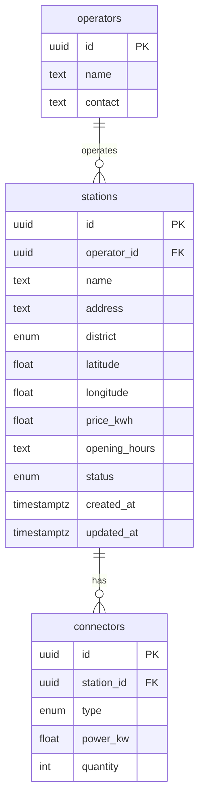

# VOLT Atlas

VOLT Atlas — учебный каталог зарядных станций Алматы. На главной можно изучить сеть, в каталоге — найти станцию на карте или в таблице, в аналитике — посмотреть распределение по районам, разъёмам, мощности и статусам.

[Открыть VOLT Atlas на Vercel](https://volt-atlas-rho.vercel.app).

Названия операторов, тарифы, разъёмы и статусы синтетические. География использует карту OpenStreetMap. По этим данным нельзя планировать фактическую зарядку.

## Локальный запуск

Требуются Node.js 24 и PostgreSQL. Подойдёт локальная база или ветка Neon.

1. Выполните `npm ci`.
2. Скопируйте `.env.example` в `.env.local`. Укажите строку PostgreSQL в `DATABASE_URL` и задайте приватный `DEMO_ACCESS_CODE` длиной от 12 символов. Для Neon используйте строку с TLS, для локального сервера — настройки вашего PostgreSQL.
3. Выполните следующие команды и откройте [локальный сайт](http://localhost:3000).

```sh
npm run db:migrate
npm run db:seed
npm run dev
```

Seed создаёт 5 вымышленных операторов, 30 станций и наборы разъёмов в 8 районах. Повторный запуск восстанавливает отсутствующие записи из набора и сохраняет правки существующих станций. Запускайте seed при настройке новой базы или для восстановления демонстрационного набора.

```sh
npm run lint
npm run typecheck
npm run build
npm start
```

## ER-диаграмма



Миграции лежат в [drizzle](drizzle). Станция и список её разъёмов сохраняются в одной транзакции, разъёмы удаляются каскадно. Средняя максимальная мощность — среднее среди станций, для каждой из которых берётся самый мощный разъём. Количество разъёмов учитывает поле `quantity`.

Чтение открыто всем. Код доступа проверяется на сервере и открывает сессию редактирования на четыре часа через подписанную HttpOnly cookie. Каждая запись в базу повторно проверяет сессию. Серверная валидация Zod проверяет поля и координаты. Передавайте демонстрационный код преподавателю приватно.

## Публикация на Vercel

1. Привяжите папку к проекту Next.js в бесплатном аккаунте Vercel Hobby через `vercel link`. Подключите бесплатный [Neon через Marketplace](https://vercel.com/marketplace/neon) или привяжите существующую бесплатную базу Neon.
2. Убедитесь, что в Preview и Production настроены серверные `DATABASE_URL` и `DEMO_ACCESS_CODE`. На Neon подойдёт pooled URL с TLS. Для отдельной preview-базы используйте её собственную строку.
3. Для каждой целевой базы задайте её `DATABASE_URL` в окружении терминала, затем выполните `npm run db:migrate` и `npm run db:seed`. Переменная процесса имеет приоритет над `.env.local`.
4. Выполните `vercel deploy --target preview`, откройте полученную ссылку и проверьте три страницы. Выполните `vercel deploy --prod` и проверьте публичный домен.

## Сценарий защиты

1. Откройте главную, выберите маркер на карте и перейдите к сведениям о станции. Укажите, что данные учебные.
2. В каталоге найдите «Атакент» по названию или адресу «Тимирязева». Сравните карту и таблицу. Покажите фильтры по району, мощности, разъёму и статусу.
3. На странице «Аналитика» запомните число станций и разъёмов. Откройте «Режим демо», введите код и добавьте станцию «Учебная точка» с координатами `43.244`, `76.925`, статусом «Действует» и одним CCS2 на 150 кВт.
4. Найдите её на карте, обновите страницу и убедитесь, что запись сохранилась. Измените количество разъёмов с 1 на 2 и проверьте, как меняются метрики.
5. Удалите «Учебную точку», подтвердите удаление и покажите исходные показатели. Завершите демонстрацию ER-диаграммой и связью станции с несколькими разъёмами.

[Концепты, фотографии и дизайн-система](docs/design/README.md).
